# AI Spec Harness (MPHarness)

[](LICENSE)
[](https://github.com/gitleaks/gitleaks)
[](https://github.com/github/spec-kit)

**MPHarness** is an enterprise-grade AI coding governance engine and project harness. It acts as the immutable operating system and security shell for AI coding assistants (Cursor, Windsurf, Claude, Copilot, Cline, etc.).

It replaces unstructured "vibe coding" with strict **Spec-Driven Development (SDD)**, prevents leaked secrets mechanically via **Gitleaks**, enforces **OWASP Top 10** security, and seamlessly orchestrates **GitHub Spec Kit** and **OpenSpec** without document duplication.

---

## Key Features

* **Mechanical Secret Protection (Gitleaks Hook):** Automatically installs a pre-commit Git hook that scans staged changes using Gitleaks (160+ detectors) and aborts commits containing API keys, private keys, or passwords.
* **Mechanical Branch Shielding:** Pre-commit hooks physically block accidental direct commits to `main` or `master`, enforcing semantic branches (`feat/`, `bugfix/`).
* **Multi-Tool Action Dispatcher:** Automatically routes new features to **GitHub Spec Kit** (`specify-cli`) and refactors/modifications to **OpenSpec** (`@fission-ai/openspec`), maintaining a single source of truth without task duplication.
* **Context Drift Immunity:** Natively injects continuous governance via `.cursorrules`, `.windsurfrules`, and `.clinerules` so the AI never forgets project rules after long conversations.
* **Hardware & Collision-Aware Orchestration:** Dynamically measures available host RAM and CPU cores before parallelizing tasks, serializing conflicting dependencies to avoid "false red" build crashes.
* **Strict OWASP & Security Constitution:** Pre-configured immutable rules requiring server-side validation, anti-CSRF tokens, HSTS, input sanitization, least privilege, and anti-enumeration.
* **Living Documentation & Auto-Archiving:** Automatically tracks progress across `TASKS.md`, `TRACKING.md`, and `SPECIFICATION.md`, autonomously modularizing large specs into `/specs/` and archiving finished milestones into `/archive/`.

---

## AI Workflow & Lifecycle

The following diagram illustrates the complete lifecycle and the strict methodology that an AI agent follows when operating within an MPHarness-governed project:

```mermaid
flowchart TD
    %% Styles
    classDef userReq fill:#2b5c8f,stroke:#fff,stroke-width:2px,color:#fff
    classDef govern fill:#4a148c,stroke:#fff,stroke-width:2px,color:#fff
    classDef spec fill:#00695c,stroke:#fff,stroke-width:2px,color:#fff
    classDef orchestrate fill:#e65100,stroke:#fff,stroke-width:2px,color:#fff
    classDef execute fill:#1565c0,stroke:#fff,stroke-width:2px,color:#fff
    classDef final fill:#2e7d32,stroke:#fff,stroke-width:2px,color:#fff

    %% Nodes
    Start(["Session Start"])
    Audit["Limbo Audit & Continuous Governance<br>(Review CONSTITUTION, git status)"]
    Req["User Requests a New Feature"]
    SpecCheck{"Is the request<br>logically viable?"}
    Pushback["Pushback Protocol:<br>Reject with evidence"]
    WriteSpec["1. Document the WHAT in SPECIFICATION.md"]
    WriteTasks["2. Document the HOW in TASKS.md"]
    WaitApprove["Wait for User Approval<br>(Coding is strictly forbidden before this)"]
    Measure["Dynamic Resource Measurement<br>(Current RAM/CPU)"]
    Collision{"Collision Analysis:<br>Do tasks touch the same<br>global/serialized files?"}
    LogPre["Pre-Delegation Logging:<br>Log assignment in TASKS.md"]
    SpawnParallel["Parallelize:<br>Spawn Multiple Subagents"]
    SpawnSeries["Sequential:<br>Run 1-by-1 to avoid<br>'false reds'"]
    Code["Write Code (Component-Level)"]
    Commit["Early Commit<br>(BEFORE verification)"]
    Verify["Exhaustive Verification<br>(Tests / Visual Validation)"]
    Fail{"Does Verification Fail?"}
    Rollback["Self-Correction Loop / Rollback"]
    Track["Update TRACKING.md"]
    Archive["Auto-Maintenance:<br>Package tasks into /archive/vX.md"]
    Done(["Phase Completed - Waiting for next instruction"])

    %% Connections
    Start --> Audit
    Audit --> Req
    Req --> SpecCheck
    SpecCheck -- Inviable --> Pushback
    Pushback --> Req
    SpecCheck -- Viable --> WriteSpec
    WriteSpec --> WriteTasks
    WriteTasks --> WaitApprove
    WaitApprove --> Measure
    
    Measure --> Collision
    Collision -- No Collision --> LogPre
    Collision -- Collision Detected --> SpawnSeries
    LogPre --> SpawnParallel
    
    SpawnParallel --> Code
    SpawnSeries --> Code
    
    Code --> Commit
    Commit --> Verify
    Verify --> Fail
    Fail -- Yes (Max 3 attempts) --> Rollback
    Rollback --> Code
    Fail -- No (Green) --> Track
    
    Track --> Archive
    Archive --> Done

    %% Apply Classes
    class Req,WaitApprove userReq
    class Audit,Pushback govern
    class SpecCheck,WriteSpec,WriteTasks spec
    class Measure,Collision,LogPre,SpawnParallel,SpawnSeries orchestrate
    class Code,Commit,Verify,Fail,Rollback execute
    class Track,Archive,Done final
```



### Workflow Phases Explained:
1. **Governance (Purple):** At the start of every session and before any task, the AI self-audits against the Constitution. If you request an unfeasible change, the *Pushback Protocol* engages with technical evidence.
2. **Spec-Driven (Teal):** The golden rule. The AI is strictly forbidden from writing code without first documenting the "What" and the "How", and obtaining your explicit approval.
3. **Orchestration (Orange):** The AI measures real-time available RAM and analyzes file collisions to determine whether tasks can run in parallel or must run sequentially to avoid ghost crashes.
4. **Execution (Blue):** The *Early Commit* occurs BEFORE verification. If a long test suite crashes, your work is already safely recorded in Git.
5. **Closure (Dark Green):** The changelog is updated and completed tasks are autonomously archived into `/archive/`, leaving an unpolluted slate for the next phase.

---

## Multi-Tool Ecosystem & Action Dispatcher

MPHarness acts as the supreme governance umbrella while harmonizing with specialized specification engines:

| User Action | Assigned Engine | Storage Boundary | Role of Root `TASKS.md` |
| :--- | :--- | :--- | :--- |
| **New Feature / Greenfield Domain** | **GitHub Spec Kit** (`specify-cli`) | Isolated in `.speckit/` | Records executive milestone only (e.g. `- [ ] Phase 2: Payments`) |
| **Modify / Refactor Existing Logic** | **OpenSpec** (`@fission-ai/openspec`) | Quarantined in `.openspec/proposals/` | Proposal tasks remain isolated until approved and merged |
| **Commits, Security & Branching** | **MPHarness** (Supreme Authority) | `.git/hooks/pre-commit`, Gitleaks | Enforces zero secrets, OWASP, and branch rules |
| **Standalone / Fallback Mode** | **MPHarness Native** | Root `SPECIFICATION.md` & `TASKS.md` | Direct native tracking when external tools are absent |

> **Anti-Duplication Rule:** The AI is strictly forbidden from duplicating line-by-line code checklists across both root `TASKS.md` and external tool files (*Zero Double-Bookkeeping*).

---

## CLI Installation & Usage

### 1. Installation
The harness is distributed as a Python CLI tool managed with `uv`.

From the repository root:
* **Windows:** `.\harness.ps1`
* **Mac/Linux:** `./harness.sh`

Or install globally with:
```bash
uv tool install -e C:\Personal\Dev\MPHarness
```

### 2. Initializing a Project
Navigate to your project directory (new or existing) and run:
```bash
harness init
```
This automatically:
* Generates all core specification templates (`CONSTITUTION.md`, `SPECIFICATION.md`, `TASKS.md`, etc.).
* Creates `.cursorrules`, `.windsurfrules`, and `.clinerules` for prompt injection.
* Configures `.gitleaks.toml` inheriting 160+ secret detection rules.
* Auto-populates `.gitignore` with secret exclusions (`.env*`, `*.pem`, `*.key`, `secrets.json`, `/docs/`).
* Installs the mechanical `pre-commit` Git hook protecting `main` and running Gitleaks.

### 3. Inspecting Ecosystem Tools
To verify active tools and routing assignments:
```bash
harness tools
```
Output:
```text
=== MPHarness Ecosystem & Action Dispatcher ===

[+] MPHarness (Supreme Governance): ACTIVE
  * Scope: OWASP Security, Gitleaks Pre-commit Hook, Branch Shielding, Context Drift Protection
[+] Gitleaks: INSTALLED & INTEGRATED
  * Scope: Mechanical secret leak blocking in pre-commit hook
[+] GitHub Spec Kit (specify-cli): DETECTED
  * Assigned For: New Features & Greenfield Domains
[+] OpenSpec (@fission-ai/openspec): DETECTED
  * Assigned For: Incremental Modifications & Refactors

Dispatch Rule: AI automatically routes New Features -> SpecKit, Modifications -> OpenSpec. Zero file collisions or duplicated checklists.
```

### 4. Validating Structure
Check if all required harness files are present:
```bash
harness check
```

### 5. Updating the Harness
Pull upstream improvements from GitHub safely into existing projects:
```bash
harness update
```
*(Templates are downloaded to `.harness/updates/`. Your AI Agent is instructed to inspect them, generate a Pre-Merge Impact Analysis Report, and ask for permission before applying.)*

---

## Practical Workflow Scenarios

### Scenario A: Building a New Feature
1. Open your project in Cursor/Windsurf.
2. Say: *"I want to build a user notification system."*
3. **AI Behavior:** The AI detects a new greenfield feature, routes it to GitHub Spec Kit, executes `/speckit.specify` and `/speckit.plan`, and logs the milestone in root `TASKS.md`. It will not code until you approve the specification.

### Scenario B: Refactoring Existing Code
1. Say: *"Change our JWT authentication to use 15-minute refresh tokens."*
2. **AI Behavior:** The AI detects a change to existing code, routes to OpenSpec, generates a quarantined delta proposal, presents the diff, and applies it upon your approval.

### Scenario C: Safe Committing
1. As code is completed, the AI makes atomic, component-level commits on a semantic branch (`feat/auth-refresh`).
2. If any API key or secret was accidentally staged, **Gitleaks intercepts the commit immediately** and blocks it before reaching Git history.

---

## License

This project is licensed under the MIT License.
