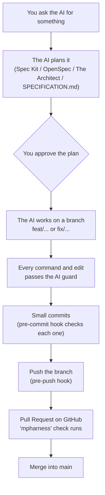

# MPHarness

[](https://github.com/mporrasor/MPHarness/actions/workflows/ci.yml)
[](LICENSE)

**Guardrails for building secure apps with AI coding agents.**

MPHarness sets up your project so that AI agents ([Claude Code](https://claude.com/claude-code) and
[Google Antigravity](https://antigravity.google)) follow safe habits, and it **enforces those habits with code**
instead of only asking nicely in a prompt. You do not need to be an expert: one command sets everything up,
every rule is explained in plain words, and `harness doctor` tells you if anything is not working.

- [What it protects you from](#what-it-protects-you-from)
- [Install](#install)
- [Quick start](#quick-start)
- [How it works](#how-it-works)
- [Everyday workflow](#everyday-workflow)
- [Planning tools](#planning-tools)
- [Your rules: governance.yaml](#your-rules-governanceyaml)
- [Commands](#commands)
- [What `harness init` creates](#what-harness-init-creates)
- [Updating](#updating)
- [Troubleshooting](#troubleshooting)
- [Limits](#limits)
- [Development](#development)

---

## What it protects you from

| If the AI (or you) tries to… | MPHarness… |
|---|---|
| Write an API key, token or password into the code | **Blocks it** and suggests a `.env` file |
| Commit or push directly to `main` | **Blocks it**: work happens on branches and Pull Requests |
| Rewrite history with `git push --force` | **Blocks it** (`--force-with-lease` on your own branch: asks you) |
| Skip the checks (`--no-verify`, `git commit -n`, changing `core.hooksPath`) | **Blocks it** |
| Commit a `.env` file, private key or certificate | **Blocks it** |
| Approve its own plan | **Blocks it**: only a person can run `harness approve` |
| Read or edit `.env` files, keys and certificates | **Asks you first** |
| Run `rm -rf`, `git reset --hard`, `git clean -f`, `DROP TABLE`, `npm publish`, `terraform destroy`… | **Asks you first** |
| Run a script straight from the internet (`curl … \| sh`, `irm … \| iex`) | **Asks you first** |
| Change the guardrails themselves (`governance.yaml`, agent hook settings, workflows, git hooks) | **Asks you first** |

When something is blocked, the AI receives a message starting with `[MPHarness]` that explains what happened
and what to do instead. The AI is instructed to explain it to you in simple words, in your language.

---

## Install

You need [Git](https://git-scm.com). The installer adds [uv](https://docs.astral.sh/uv/) (a Python tool manager)
if you do not have it, then installs the `harness` command.

**Windows (PowerShell)**
```powershell
irm https://raw.githubusercontent.com/mporrasor/MPHarness/v0.2.0/harness.ps1 | iex
```

**macOS / Linux**
```bash
curl -LsSf https://raw.githubusercontent.com/mporrasor/MPHarness/v0.2.0/harness.sh | bash
```

Or directly with uv:
```bash
uv tool install "git+https://github.com/mporrasor/MPHarness@v0.2.0"
```

Recommended extras:

| Tool | Why | Install |
|---|---|---|
| [Gitleaks](https://github.com/gitleaks/gitleaks) | Full secret scanning (160+ detectors) in git hooks | `winget install Gitleaks.Gitleaks` / `brew install gitleaks` |
| [GitHub CLI](https://cli.github.com) | Needed by `harness github apply` | `winget install GitHub.cli` / `brew install gh`, then `gh auth login` |

---

## Quick start

```bash
cd my-project           # a new, empty folder or an existing project
harness init            # answers a few questions and sets everything up
harness doctor          # checks that every protection is working
```

`harness init` asks (or detects):

1. **Your GitHub repository** (`owner/name`), read from the git remote when there is one.
2. **New project or existing code**, detected from git history and files.
3. **A planning tool**, recommended from step 2 (see [Planning tools](#planning-tools)).

Then push your code to GitHub and run:

```bash
harness github apply    # protects main on GitHub and turns on Dependabot and secret scanning
```

Run `harness init --yes` to accept every detected value without questions.

---

## How it works

All rules live in one file, **`governance.yaml`**, and the same rules are checked at four points:


### 1. AI guard (before anything happens)

`harness init` registers a *PreToolUse hook* in each agent. Before the agent runs a command or touches a file,
the agent sends the action to `harness guard`, which answers **allow**, **ask** (you confirm) or **deny**.

| Agent | Config file | Actions checked |
|---|---|---|
| Claude Code | `.claude/settings.json` | `Bash`, `PowerShell`, `Edit`, `MultiEdit`, `Write`, `NotebookEdit`, `Read` |
| Antigravity | `.agents/hooks.json` | `run_command`, `write_to_file`, `replace_file_content`, `multi_replace_file_content`, `view_file` |

The guard **fails closed**: if it cannot understand an action or crashes, the action is blocked. In Claude Code
the hook runs `harness guard --agent claude || exit 2`, so even a missing `harness` command blocks instead of
allowing. Existing settings and hooks in those files are kept; MPHarness only adds its own entry.

### 2. Git hooks (before commit and push)

`harness init` installs `pre-commit` and `pre-push` hooks that run `harness verify`:

| Stage | Checks |
|---|---|
| `pre-commit` | Not on a protected branch (the very first commit of a new repo is allowed) · no secret files staged (`.env`, keys…) · no secrets in the staged changes (Gitleaks, plus a built-in scanner) · `governance.yaml` is valid |
| `pre-push` | No pushes that update or delete a protected branch (creating `main` the first time is allowed) · no force pushes (detected by comparing commits) |

If your project already had a git hook, it is kept as `pre-commit.local` / `pre-push.local` and still runs after
MPHarness. If you use a hook manager (husky, lefthook: `core.hooksPath` is set), MPHarness does not touch it and tells
you to add `harness verify --stage pre-commit` and `--stage pre-push` there.

### 3. GitHub Actions (on GitHub's servers)

`.github/workflows/mpharness.yml` runs on every Pull Request and on pushes to protected branches. It installs the
same MPHarness version (pinned to a tag) and Gitleaks, then runs `harness verify --stage ci`:

- full secret scan of the repository,
- no secret files tracked by git,
- `governance.yaml` is valid,
- **the AI guards are still installed and enabled** for every agent listed in `governance.yaml`
  (this catches a change that removed or disabled them, e.g. `disableAllHooks: true`).

The job is called **`mpharness`**: that is the name of the required check.

### 4. GitHub settings (`harness github apply`)

Using the GitHub CLI, MPHarness turns on:

- a ruleset named **"MPHarness protection"** on the default branch and every protected branch:
  changes only through Pull Requests, the `mpharness` check must pass, no force pushes, no deletion;
- **Dependabot alerts** and **automatic security fixes**;
- **secret scanning** and **push protection** (GitHub rejects pushes that contain known secret formats).

Each step is independent. If your GitHub plan does not include a feature (some need GitHub Pro/Team on private
repositories), you are told in plain words and everything else is still applied. Gitleaks in the CI check covers
secret scanning when GitHub's own is not available.

**Why four layers?** Layers 1 and 2 run on your computer and give instant feedback, but anyone with access to the
computer can switch them off. Layers 3 and 4 run on GitHub and cannot be skipped: they are the final safety net.

### The agent's working agreement

`harness init` also writes a short **`AGENTS.md`** (read by Antigravity and most agents; `CLAUDE.md` imports it for
Claude Code). It tells the AI to:

- reply in the user's language, explain simply, and say how to try each change;
- write code, comments, commits and docs in English;
- treat `[MPHarness]` messages as real limits, explain them, and never work around them;
- plan first (with the project's planning tool), work on branches, make small commits, verify, deliver via PR;
- push back with evidence when a request is unsafe or contradicts earlier decisions;
- follow a secure-by-default checklist (secrets, input validation, auth, web security headers, webhooks,
  least privilege, rate limits, AI prompt injection, safe logging);
- add dependencies carefully and show you a table before upgrading any.

MPHarness owns only the text between `<!-- mpharness:begin -->` and `<!-- mpharness:end -->`. Anything you write
below it (the *Project notes* section) is never changed.

---

## Everyday workflow



1. Describe what you want. The AI writes a plan and waits for your OK.
2. The AI creates a branch, makes small commits and runs the tests. If it hits a guardrail, it tells you why.
3. The branch is pushed and a Pull Request is opened. The `mpharness` check must pass.
4. You merge. Dependabot will also open Pull Requests to keep dependencies safe.

**Optional stricter mode:** set `require_plan_approval: true` in `governance.yaml`. The AI then cannot edit any code
file (planning documents are still allowed) until you run `harness approve` in a terminal. The approval belongs to
the current branch and is stored on your computer only (`.harness/approval.json`, git-ignored).

---

## Planning tools

| Your project | Recommended | How the AI uses it |
|---|---|---|
| New | [GitHub Spec Kit](https://github.com/github/spec-kit) | `/speckit-specify` → `/speckit-plan` → `/speckit-tasks` → `/speckit-implement` |
| Existing code | [OpenSpec](https://github.com/Fission-AI/OpenSpec) | `/openspec-propose <change>` → your OK → `/openspec-apply-change` → `/openspec-archive-change` |
| Either, Claude Code only | [The Architect](https://github.com/Hainrixz/the-architect) | `/architect` (new app) or `/architect-brownfield` (change), then `/architect-next` step by step |
| Keep it minimal | `none` | A short `SPECIFICATION.md` (what and why) and `TASKS.md` (checklist) |

`harness init` offers to install the chosen tool; you can also run `harness planner setup` later. It runs:

| Planner | Commands |
|---|---|
| Spec Kit | `uv tool install specify-cli` · `specify init --here --force --integration claude` (or `agy` for Antigravity) |
| OpenSpec | `npm install -g @fission-ai/openspec@latest` · `openspec init --scope project --tools claude,antigravity` |
| The Architect | `claude plugin marketplace add Hainrixz/the-architect` · `claude plugin install the-architect@soyenriquerocha` |

The Architect is a third-party plugin. It does not install hooks or scripts, but while generating a blueprint it
can run the blueprint's bootstrap commands to test them; the AI guard still checks each of those commands.

---

## Your rules: `governance.yaml`

Created by `harness init` and never overwritten. Change `true` to `false` to turn a rule off, then run `harness doctor`.

```yaml
version: 1

project:
  repository: "owner/name"   # GitHub repository
  stage: new                 # new = new project · existing = code already started
  planner: speckit           # architect | speckit | openspec | none

agents: [claude, antigravity]   # AI tools protected by guard hooks

branches:
  protected: [main, master]     # Branches nobody commits to directly

rules:
  block_secrets_in_code: true        # Stops the AI from writing passwords or keys into code
  protect_secret_files: true         # Asks before the AI reads or edits .env files, keys and certificates
  block_commits_to_protected: true   # The AI works on branches, never directly on main
  block_force_push: true             # Prevents rewriting history with "git push --force"
  block_skipping_checks: true        # Prevents skipping checks (--no-verify, core.hooksPath)
  ask_before_destructive: true       # Asks before mass deletes, "git reset --hard", DROP TABLE…
  ask_before_remote_scripts: true    # Asks before running scripts from the internet (curl … | sh)
  protect_governance_files: true     # Asks before the AI changes these rules or the workflows
  require_plan_approval: false       # If true, the AI cannot edit code until you run "harness approve"

custom:
  blocked_commands: []    # Extra commands the AI may not run, e.g. ["docker system prune"] (regular expressions)
  protected_paths: []     # Extra files or folders that need your permission, e.g. ["infra/*"]
```

If the file is missing or has a typo, MPHarness uses the strict defaults above rather than switching rules off,
and `harness doctor` / the CI check report the error.

**What counts as a secret file:** `.env`, `.env.*`, `*.env`, `*.pem`, `*.key`, `*.p12`, `*.pfx`, `*.keystore`,
`id_rsa*`, `id_ed25519*`, `id_ecdsa*`, `secrets.json`, `credentials.json`, `*.tfvars`
(`.env.example`, `.env.sample`, `.env.template` and `*.pub` are fine).

**What the built-in scanner recognizes** (Gitleaks recognizes many more): private keys, AWS access keys, GitHub
tokens, Anthropic and OpenAI API keys, Stripe live keys, Slack tokens, Google API keys, and database URLs with an
embedded password. Secrets inside `.env`-style files are expected and are not flagged there.

---

## Commands

| Command | What it does |
|---|---|
| `harness init` | Set up (or repair) MPHarness in a project. Safe to run again. Options: `--repo`, `--stage`, `--planner`, `--agents`, `--yes`. |
| `harness doctor` | Check every protection, including a live test that the AI guard blocks a force push, and explain how to fix problems. |
| `harness github apply` | Apply the GitHub protection described above to the repository in `governance.yaml`. Asks before changing anything. |
| `harness planner setup` | Install and initialize the planning tool chosen in `governance.yaml`. |
| `harness audit` | Check dependencies for known vulnerabilities and outdated versions (npm/pnpm/yarn, Python with pip-audit, .NET). |
| `harness approve` | Approve the current plan for this branch (only with `require_plan_approval: true`). `--revoke` removes it. |
| `harness update` | Refresh MPHarness-managed files and hooks from the installed version. |
| `harness verify --stage pre-commit\|pre-push\|ci` | The checks run by git hooks and CI. |
| `harness guard --agent claude\|antigravity` | The entry point the AI agents call. Not meant to be run by hand. |

`harness doctor` output looks like this:

```text
OK MPHarness is installed
OK governance.yaml found (planner: speckit)
OK Claude Code guard is active (.claude/settings.json)
OK Antigravity guard is active (.agents/hooks.json)
OK Self-test: a forced push by the AI is blocked
OK Git hooks run MPHarness before each commit and push
OK No secret files are tracked by git
OK Gitleaks is installed (full secret scanning)
OK .gitignore keeps secrets out of git
OK GitHub check workflow present (.github/workflows/mpharness.yml)
OK Dependabot config present (.github/dependabot.yml)
OK GitHub protection is active on owner/name

All protections are working.
```

---

## What `harness init` creates

| File | Purpose | Who owns it |
|---|---|---|
| `governance.yaml` | Your rules | You (created once, never overwritten) |
| `AGENTS.md` | Working agreement for the AI | MPHarness block + your notes below it |
| `CLAUDE.md` | Makes Claude Code read `AGENTS.md` | MPHarness block + your notes |
| `.claude/settings.json` | Claude Code guard hook | Merged: your other settings are kept |
| `.agents/hooks.json` | Antigravity guard hook | Merged: your other hooks are kept |
| `.git/hooks/pre-commit`, `pre-push` | Git checks | MPHarness (your old hooks kept as `*.local`) |
| `.github/workflows/mpharness.yml` | The `mpharness` CI check | MPHarness (kept if you remove its header) |
| `.github/dependabot.yml` | Dependency updates for the ecosystems found (npm, uv/pip, NuGet, Docker, Go, Cargo, Composer, Maven, Gradle, Bundler, GitHub Actions) | MPHarness (kept if you remove its header) |
| `.gitleaks.toml` | Gitleaks settings (default rules + a few safe paths) | You (created once) |
| `.gitignore` | Adds secret files and local MPHarness files | Entries appended, nothing removed |
| `SPECIFICATION.md`, `TASKS.md` | Only with `planner: none` | You (created once) |

It also creates the git repository (branch `main`) if the folder does not have one yet.

---

## Updating

1. Install the new version (replace the tag):
   ```bash
   uv tool install --force "git+https://github.com/mporrasor/MPHarness@v0.2.0"
   ```
2. In each project:
   ```bash
   harness update
   ```
   This refreshes the MPHarness blocks in `AGENTS.md`/`CLAUDE.md`, the managed workflow and Dependabot files,
   the `.gitignore` entries, the agent guards and the git hooks. Your `governance.yaml`, your notes and any file
   you customized are left alone. Nothing is downloaded at runtime: templates come with the installed version.

**Upgrading from MPHarness 0.1:** run `harness init` in the project. The old files (`CONSTITUTION.md`,
`ARCHITECTURE.md`, `MANUAL.md`, `TRACKING.md`, `.cursorrules`, `.windsurfrules`, `.clinerules`, the old `AGENTS.md`)
are moved to `.harness/legacy/`. Ask your AI to copy anything project-specific into the *Project notes* section of
`AGENTS.md`, then delete that folder.

---

## Troubleshooting

| Problem | What to do |
|---|---|
| The AI says every action is blocked | `harness` is probably not on the PATH of the agent. Open a new terminal, run `harness --version`; reinstall if needed, then `harness doctor`. |
| A commit is blocked on `main` | Create a branch: `git switch -c feat/my-change`, then commit again. |
| A commit is blocked for a secret | Move the value to `.env`, read it from an environment variable, and **replace the key** if it was ever shared. |
| `git push` to `main` is blocked | Push your branch and open a Pull Request: `git push -u origin feat/my-change`. |
| "Gitleaks is not installed" warning | Install it (see [Install](#install)) for full scanning; the basic scanner still runs. |
| `harness github apply` says a feature is not available | Your GitHub plan does not include it for this repository; the other protections are still active. |
| You use husky or lefthook | Add `harness verify --stage pre-commit` and `harness verify --stage pre-push` to those hooks. |
| You want to remove MPHarness | Delete the MPHarness entry from `.claude/settings.json` and `.agents/hooks.json`, delete `.git/hooks/pre-commit` and `pre-push` (rename any `*.local` back), and remove `.github/workflows/mpharness.yml` and the ruleset on GitHub. |

---

## Limits

- Local guards and git hooks can be switched off by anyone with access to the computer. The GitHub check and
  settings are the real guarantee, so apply them with `harness github apply`.
- The AI guard looks at each command as text. It catches the common risky patterns listed above, not every
  possible way of doing damage; that is why destructive and remote-script commands ask you instead of guessing.
- Secret detection catches high-confidence formats; Gitleaks adds 160+ detectors. No scanner catches everything:
  treat any exposed key as compromised and rotate it.
- Some GitHub features on **private** repositories need a paid plan.
- The AI guard supports Claude Code and Antigravity. Other agents still benefit from layers 2–4 and `AGENTS.md`.
- Antigravity's documentation does not say what happens when a hook command is missing; `harness doctor` checks it.

---

## Development

```bash
git clone https://github.com/mporrasor/MPHarness
cd MPHarness
uv sync
uv run pytest
```

| Module | Responsibility |
|---|---|
| `governance.py` | Loads `governance.yaml` with strict defaults |
| `policy.py` | The policy engine: allow / ask / deny for commands and file actions |
| `secrets_scan.py` | Built-in high-confidence secret patterns |
| `adapters.py` | Translates Claude Code and Antigravity hook payloads |
| `installers.py` | Merges guard hooks into each agent's settings |
| `githooks.py` · `verify.py` | Git hooks and the pre-commit / pre-push / CI checks |
| `github.py` | CI workflow, Dependabot config, GitHub protection via `gh` |
| `scaffold.py` · `planners.py` | `init` / `update` file generation and planning tools |
| `doctor.py` · `audit.py` · `cli.py` | Health check, dependency audit, command line |

Changes go through Pull Requests; CI runs the tests on Linux, Windows and macOS. Releases are git tags (`vX.Y.Z`);
generated workflows and installers pin to the tag of the installed version.

## License

[MIT](LICENSE)
