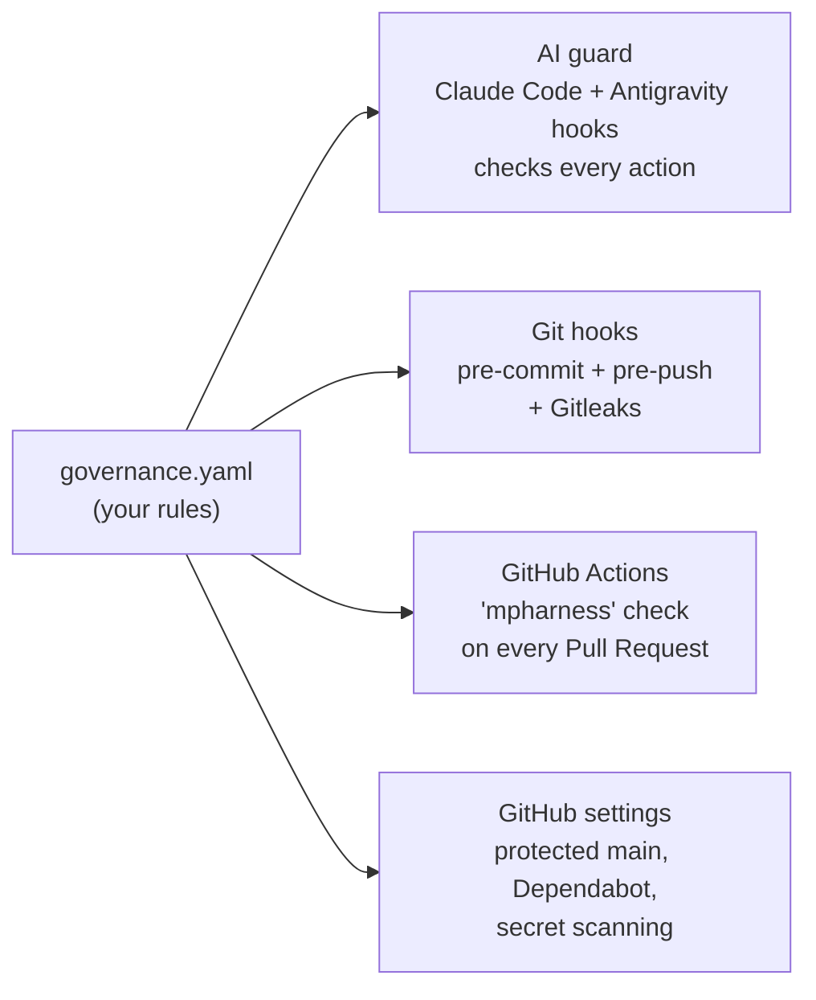

# MPHarness

[](LICENSE)

**Guardrails for building secure apps with AI coding agents.**

MPHarness sets up a project so that AI agents ([Claude Code](https://claude.com/claude-code) and
[Google Antigravity](https://antigravity.google)) follow safe habits, and it **enforces them with code**
instead of only asking nicely in a prompt. You do not need to be an expert: one command sets everything
up, and every rule is explained in plain words.

## What it protects you from

| If the AI (or you) tries to… | MPHarness… |
|---|---|
| Write an API key, token or password into the code | **Blocks it** and suggests using a `.env` file |
| Commit or push directly to `main` | **Blocks it**: work happens on branches and Pull Requests |
| `git push --force`, or skip checks with `--no-verify` | **Blocks it** |
| Commit a `.env` file, private key or certificate | **Blocks it** |
| Read or edit `.env` files and keys | **Asks you first** |
| Run `rm -rf`, `git reset --hard`, `DROP TABLE`, `curl … \| sh` | **Asks you first** |
| Change the guardrails themselves (`governance.yaml`, hooks, workflows) | **Asks you first** |
| Approve its own plan | **Blocks it**: only you can run `harness approve` |

## How it works

Every rule lives in one file, `governance.yaml`, and is checked at four points:



1. **AI guard**: before the agent runs a command or edits a file, MPHarness checks it and answers
   *allow*, *ask you* or *block*. If MPHarness itself is missing or crashes, the action is blocked.
2. **Git hooks**: the same rules run before every commit and push, plus a secret scan with
   [Gitleaks](https://github.com/gitleaks/gitleaks).
3. **GitHub Actions**: the same checks run on GitHub for every Pull Request, so nothing skips them.
4. **GitHub settings**: `main` only accepts Pull Requests that pass the check. Dependabot keeps your
   dependencies patched, and secret scanning is turned on where your GitHub plan allows it.

Local protections can be switched off by someone with access to the computer. Layers 3 and 4 run
on GitHub's servers, so they are the final safety net.

It also writes a short **AGENTS.md** (read by both agents; `CLAUDE.md` imports it) with a working agreement:
plan first, work on branches, small commits, a secure-by-default checklist (OWASP basics), and
"explain things simply, in the user's language".

## Install

You need [Git](https://git-scm.com). The installer adds [uv](https://docs.astral.sh/uv/) if you do not have it.

**Windows (PowerShell)**
```powershell
irm https://raw.githubusercontent.com/mporrasor/MPHarness/v0.2.0/harness.ps1 | iex
```

**macOS / Linux**
```bash
curl -LsSf https://raw.githubusercontent.com/mporrasor/MPHarness/v0.2.0/harness.sh | bash
```

Or directly with uv: `uv tool install "git+https://github.com/mporrasor/MPHarness@v0.2.0"`

Recommended: install Gitleaks for full secret scanning (`winget install Gitleaks.Gitleaks` or `brew install gitleaks`)
and the [GitHub CLI](https://cli.github.com) for `harness github apply`.

## Use it

```bash
cd my-project
harness init            # answers a few questions and sets everything up
harness doctor          # checks that every protection works
```

`harness init` works for **new projects and existing code**. It detects which one you have and recommends
a planning tool:

| Your project | Recommended planner | What it does |
|---|---|---|
| New | [GitHub Spec Kit](https://github.com/github/spec-kit) | Spec → plan → tasks → build |
| Existing code | [OpenSpec](https://github.com/Fission-AI/OpenSpec) | Proposes each change as a reviewable delta |
| Either (Claude Code only) | [The Architect](https://github.com/Hainrixz/the-architect) | Interviews you and writes a full blueprint |
| Keep it minimal | `none` | A short `SPECIFICATION.md` and `TASKS.md` |

When your repository is on GitHub:

```bash
harness github apply    # protects main, requires the check, turns on Dependabot and secret scanning
```

## Commands

| Command | What it does |
|---|---|
| `harness init` | Set up (or repair) MPHarness in a project. Safe to run again. |
| `harness doctor` | Check every protection, with a live test, and explain how to fix problems. |
| `harness github apply` | Apply protection to the GitHub repository set in `governance.yaml`. |
| `harness planner setup` | Install the planning tool chosen in `governance.yaml`. |
| `harness audit` | Check dependencies for known vulnerabilities (npm, Python, .NET). |
| `harness approve` | Approve the plan, if you turned on `require_plan_approval`. |
| `harness update` | Refresh MPHarness files after upgrading. Your notes and rules are kept. |
| `harness verify` / `harness guard` | Used internally by git hooks, CI and the AI agents. |

## Your rules: `governance.yaml`

```yaml
rules:
  block_secrets_in_code: true        # Stops the AI from writing passwords or keys into code
  protect_secret_files: true         # Asks before the AI reads or edits .env files, keys and certificates
  block_commits_to_protected: true   # The AI works on branches, never directly on main
  block_force_push: true             # Prevents rewriting history with "git push --force"
  block_skipping_checks: true        # Prevents skipping checks (--no-verify, core.hooksPath)
  ask_before_destructive: true       # Asks before mass deletes, "git reset --hard", DROP TABLE…
  ask_before_remote_scripts: true    # Asks before running scripts from the internet (curl … | sh)
  protect_governance_files: true     # Asks before the AI changes these rules or the workflows
  require_plan_approval: false       # If true, the AI cannot edit code until you run "harness approve"
custom:
  blocked_commands: []               # e.g. ["docker system prune"]
  protected_paths: []                # e.g. ["infra/*"]
```

Change `true` to `false` to turn a rule off, then run `harness doctor`.

## Upgrading from MPHarness 0.1

Run `harness init` in the project. Old files (`CONSTITUTION.md`, `.cursorrules`, `.windsurfrules`,
`.clinerules`, `ARCHITECTURE.md`, `MANUAL.md`, `TRACKING.md`, the old `AGENTS.md`) are moved to
`.harness/legacy/`. Ask your AI to copy anything project-specific into the *Project notes* section of
`AGENTS.md`, then delete that folder.

## Limits (honest list)

- Local guards and git hooks can be turned off by anyone with access to the computer; the GitHub
  check and settings are the real guarantee.
- Secret detection catches common, high-confidence formats; Gitleaks adds 160+ detectors. No scanner
  catches everything, so treat any exposed key as compromised and rotate it.
- Some GitHub features (rulesets and secret scanning on **private** repositories) need a paid GitHub plan.
  `harness github apply` tells you which ones were not available.
- The AI guard currently supports Claude Code and Antigravity.

## Development

```bash
uv sync
uv run pytest
```

## License

[MIT](LICENSE)
